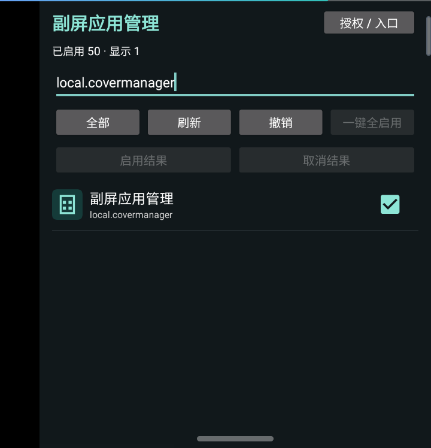
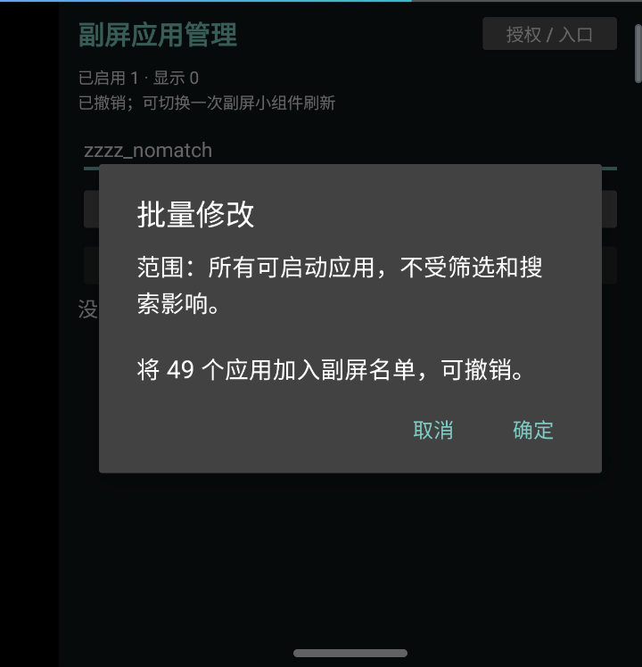
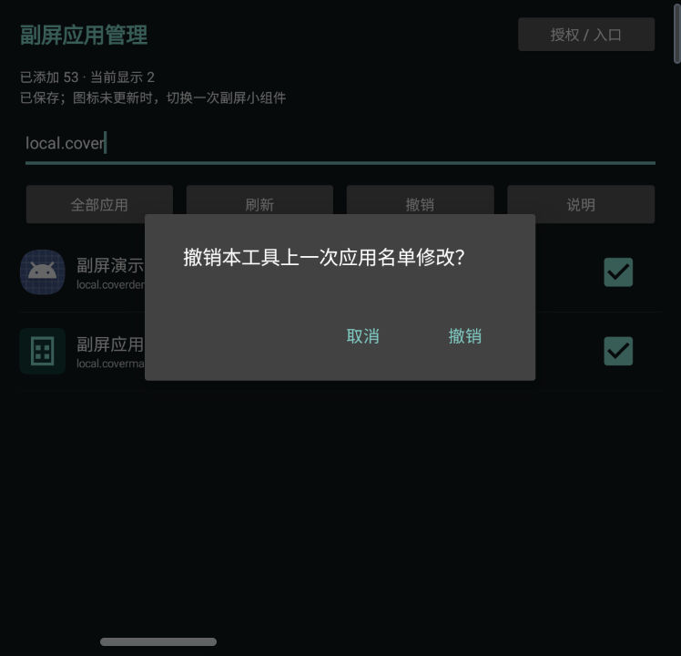
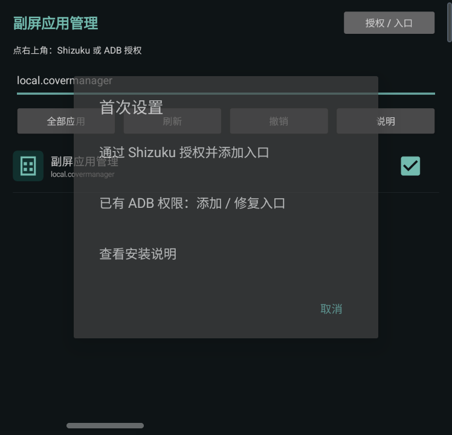
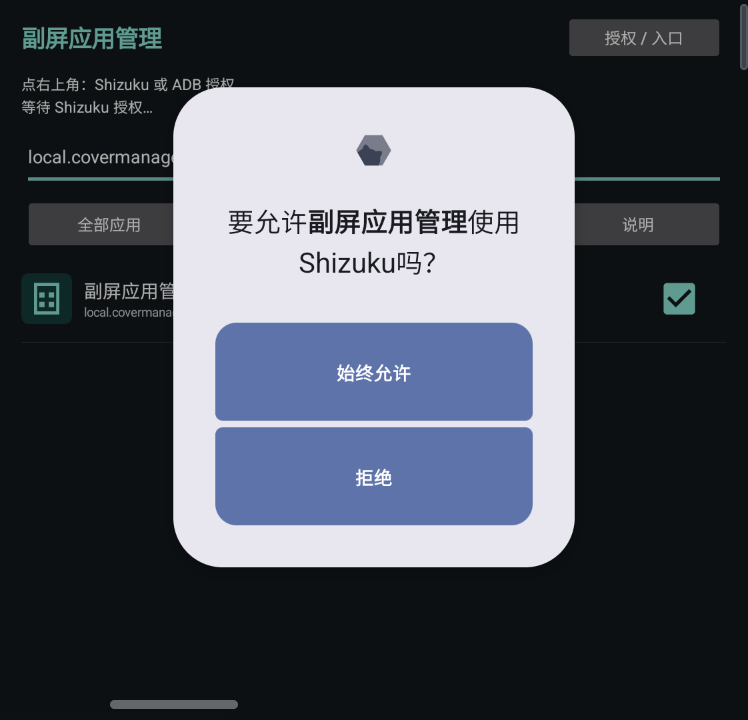
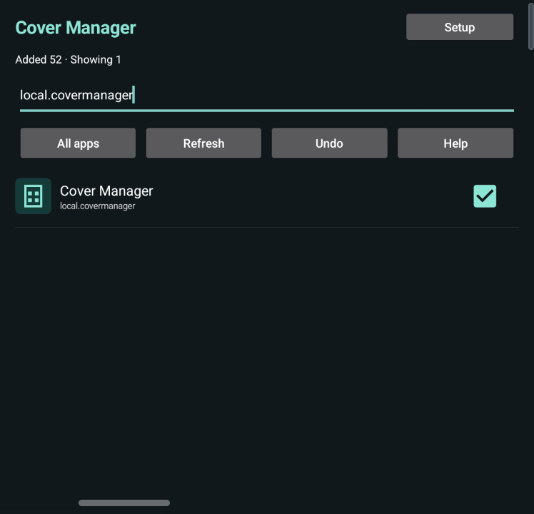

# Z Flip Cover Manager

[简体中文](README.md) · English

Manage the MultiStar app list from the Galaxy Z Flip5 cover screen. After one-time authorization, add newly installed apps without opening the inner display.

**[Download APK](https://github.com/andyfanybo/zflip-cover-manager/releases/latest)** · [Technical notes](docs/implementation.md) · [MIT License](LICENSE)

## Interface

| Main screen | Enable-all confirmation | Undo |
| --- | --- | --- |
|  |  |  |

<details>
<summary>Setup and English interface</summary>

| Setup | Shizuku authorization | English UI |
| --- | --- | --- |
|  |  |  |

</details>

Screenshots are from development and device testing; some show earlier interfaces. Personal app lists are excluded. Enable buttons are dimmed when all apps in their scope are already enabled.

## Installation

### Shizuku

1. Install and start [Shizuku](https://shizuku.rikka.app/) v13 or newer.
2. Install the APK and open Cover Manager.
3. Choose **Setup → Authorize with Shizuku and add entry**, then allow the request.

Shizuku does not need to keep running afterward. You must be able to open this tool for the first time. If the inner display is broken and your existing cover launcher cannot open it, use ADB below.

### ADB

Download the APK and `setup.ps1` from the release page. On Windows with Android Platform Tools installed, run:

```powershell
.\setup.ps1 -Device 'SERIAL_OR_IP:PORT' -ApkPath '.\CoverManager-v0.4.0.apk'
```

The script installs the app, grants permission, backs up the configuration and adds the cover entry. Backups are saved to `.covermanager-backups` in the current directory.

Or install and authorize manually:

```sh
adb -s DEVICE install -r CoverManager-v0.4.0.apk
adb -s DEVICE shell pm grant local.covermanager android.permission.WRITE_SECURE_SETTINGS
adb -s DEVICE shell am start --display 1 -n local.covermanager/.MainActivity
```

Then choose **Setup → ADB already granted: add / repair entry**. Unlock the phone first. Display ID `1` is the cover screen on the test device.

## Usage

| Action | Scope |
| --- | --- |
| Top Enable all | Every launchable app, ignoring search and filters |
| Enabled → Disable all | Current filter and search results; keeps the manager entry |
| Disabled → Enable all | Current filter and search results |
| Undo | Restores the last change, including an entire batch |

Enabled means included in the MultiStar cover list, not currently running. You can also select apps individually. Refresh after installing an app, and switch cover widgets if icons have not updated.

Uses the system font and supports Chinese and English. No MultiStar version restriction; unknown configuration formats are read-only. Tested on Z Flip5 SC-54D / Android 15 / One UI 7. Minimum Android version: 11.

## Build

Requires JDK 17, Android SDK Platform 35 and Build Tools 35.0.0:

```powershell
.\build.ps1 -Jdk 'C:\path\to\jdk-17' -AndroidSdk 'C:\path\to\Android\Sdk'
```

Output: `build/CoverManager-v0.4.0.apk`. The script downloads and checks the Shizuku dependencies, runs tests and creates a development signing key. Its signature differs from the Release. Keep your own key for future updates.

Report issues in [Issues](https://github.com/andyfanybo/zflip-cover-manager/issues), including the device, system and MultiStar versions. Do not publish complete configuration backups or personal app lists.

[MIT License](LICENSE). Shizuku attribution: [third-party license](docs/SHIZUKU-LICENSE.txt).
