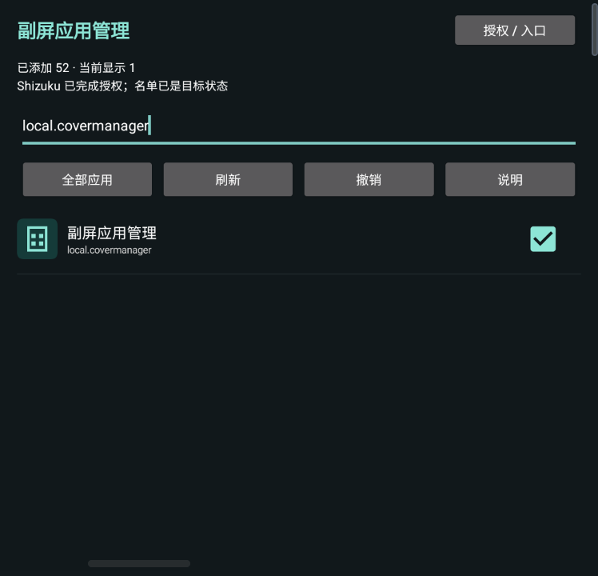

# Z Flip Cover Manager

**[简体中文](README.md) · English**

**Manage the MultiStar app list directly from the Galaxy Z Flip5 cover screen.** Add newly installed apps without reopening the inner display after initial setup.

[](LICENSE)
[](https://github.com/andyfanybo/zflip-cover-manager/releases/latest)

**[Download APK](https://github.com/andyfanybo/zflip-cover-manager/releases/latest) · [Setup](#installation-and-authorization) · [Technical notes](#how-it-works)**

## Why this exists

MultiStar can launch apps on the Z Flip5 cover screen, but adding a newly installed app usually involves opening its settings on the inner display. That becomes difficult when the inner display is broken.

This tool provides a small-screen app list. After a one-time authorization, search and select apps directly on the cover screen.

- Search by app name or package name; select to add and clear to remove.
- Refresh the list after installing another app.
- Filter to selected apps and undo the last ordinary app-list change.
- Set up with **ADB** or **Shizuku**.
- No root required. The app does not request Internet access.
- Uses the system default font. Follows the system language by default: Chinese for Chinese locales, English for all other locales. A manual language choice is available under **Setup → Language**.
- Validates the MultiStar version and configuration format, preserving unrelated settings.

## Screenshots

These are real SC-54D cover-screen captures. The search is filtered to this tool to avoid publishing a personal app list. The rectangular 748×720 capture includes areas around the physical display cutout and system UI.


| Setup options | Shizuku permission request | Authorization complete |
| --- | --- | --- |
|  |  |  |

The setup screenshots above were captured with the phone using Chinese. In v0.3.0, the app also provides English setup, help, confirmation, status and error messages.

## Compatibility

| Component | Verified environment |
| --- | --- |
| Phone | Samsung Galaxy Z Flip5, Japanese SC-54D |
| System | Android 15 / One UI 7 |
| MultiStar | **9.1.09** |
| Shizuku | Tested with 13.6.0; requires v13 or newer |
| App minimum | Android 11 / API 30; this does not imply all devices are supported |

**Writing is currently enabled only for MultiStar 9.1.09.** Other versions or unexpected configuration formats are read-only. Other phones, Z Flip6/7 and other One UI versions have not been verified. This project is not affiliated with Samsung, Good Lock, MultiStar or Shizuku.

## Installation and authorization

Both methods use the same APK. They differ in how the initial permission and the tool's own cover-screen entry are established.

| Method | Best for | Prerequisites |
| --- | --- | --- |
| ADB | Computer users, including those who need a computer to establish the first cover entry | An authorized USB or wireless ADB connection |
| Shizuku | Users who prefer tapping through setup on the phone | A running Shizuku service and a way to open this tool for the first time |

### Option 1: ADB

Download the APK from [Releases](https://github.com/andyfanybo/zflip-cover-manager/releases/latest). Windows users can also download `setup.ps1` from the same release and run it with Android Platform Tools installed:

```powershell
.\setup.ps1 -Device 'SERIAL_OR_IP:PORT' -ApkPath '.\CoverManager-v0.3.0.apk'
```

The script installs the APK, grants permission, saves a local configuration backup, adds the tool to both cover lists and verifies that unrelated fields are unchanged. Backups are stored in `.covermanager-backups` under the current working directory. Keep them private.

Alternatively, run the commands manually:

```sh
adb -s DEVICE install -r CoverManager-v0.3.0.apk
adb -s DEVICE shell pm grant local.covermanager android.permission.WRITE_SECURE_SETTINGS
adb -s DEVICE shell am start --display 1 -n local.covermanager/.MainActivity
```

Open **Setup → ADB already granted: add / repair entry**. Unlock the phone normally if necessary. Display ID `1` was verified on the test device; confirm the correct display on other devices.

### Option 2: Shizuku

1. Install and start [Shizuku](https://shizuku.rikka.app/). Installing it without starting its service is insufficient.
2. Install the APK from this repository's Releases and open Cover Manager.
3. Select **Setup → Authorize with Shizuku and add entry**.
4. Choose **Allow all the time** in the Shizuku prompt.
5. When the app shows **Shizuku authorization complete**, return to MultiStar. Switch to another cover widget and back if the icon has not refreshed.

Shizuku performs a one-time grant. Normal app-list changes then run directly in Cover Manager, without a continuously running Shizuku service or computer connection.

> **First launch matters:** Shizuku cannot automatically place an app that has never been opened on the cover screen. If the inner display is broken and no existing cover-screen entry can open a new app, use an available launcher, an existing remote-control solution, or the ADB method to complete the first launch. Having Shizuku installed alone does not remove this requirement.

## Daily use

1. Open Cover Manager from MultiStar.
2. Tap **Refresh** after installing another app, then search for it.
3. Select the checkbox to add it, or clear the checkbox to remove it.
4. Switch cover widgets if MultiStar icons have not refreshed.

Tap an app name to try opening it on the current display. Behavior still depends on Samsung policies and the target app. The tool keeps its own checkbox selected to preserve the management entry.

**Undo** restores the last ordinary list change made by this tool. It refuses to overwrite changes made by another app. Establishing the tool's own entry is not recorded as an undoable change.

## How it works

MultiStar 9.1.09 stores its configuration in `Settings.Secure.multistar_setting_repository`. The tool changes only two fields: index `20` contains package names, while index `25` contains package names with Android user IDs. Other fields are preserved verbatim.

The required `WRITE_SECURE_SETTINGS` permission is broader than these two fields. Grant it only to a build you trust. The Shizuku UserService accepts one fixed operation: granting this permission to `local.covermanager`. It checks the calling UID and accepts no arbitrary package name, permission or shell command. The temporary service exits after setup.

The [technical notes and verification record](docs/implementation.md) are currently available in Chinese. No Samsung APK, decompiled Samsung source, device backup or signing key is distributed.

## Build from source

Requires Windows PowerShell, JDK 17, Android SDK Platform 35 and Build Tools 35.0.0:

```powershell
.\build.ps1 -Jdk 'C:\path\to\jdk-17' -AndroidSdk 'C:\path\to\Android\Sdk'
```

The script downloads four Shizuku API 13.1.5 components from Maven Central, verifies SHA-256 hashes from `dependencies.json`, runs the repository-parser tests, then builds and verifies `build/CoverManager-v0.3.0.apk`.

Local builds generate a development signing key by default. This signature differs from the official Release and cannot update an installed Release in place. Retain your own key for future updates. The repository does not contain a signing private key. CI validates builds and is not the source of stable signed releases.

## Reporting issues

Open an [issue](https://github.com/andyfanybo/zflip-cover-manager/issues) with your device, Android / One UI / MultiStar versions, authorization method and reproduction steps. Do not publish complete backups, device serial numbers, ADB pairing codes or personal app lists.

## License

[MIT License](LICENSE). The Shizuku API is also MIT-licensed; its copyright notice is included in [SHIZUKU-LICENSE.txt](docs/SHIZUKU-LICENSE.txt).
