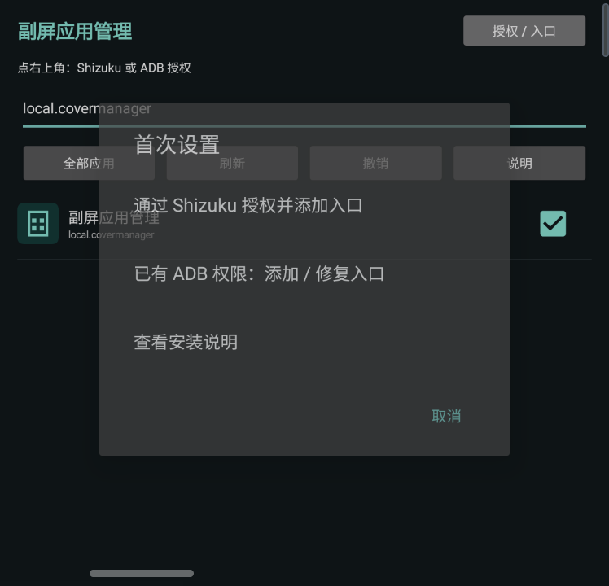
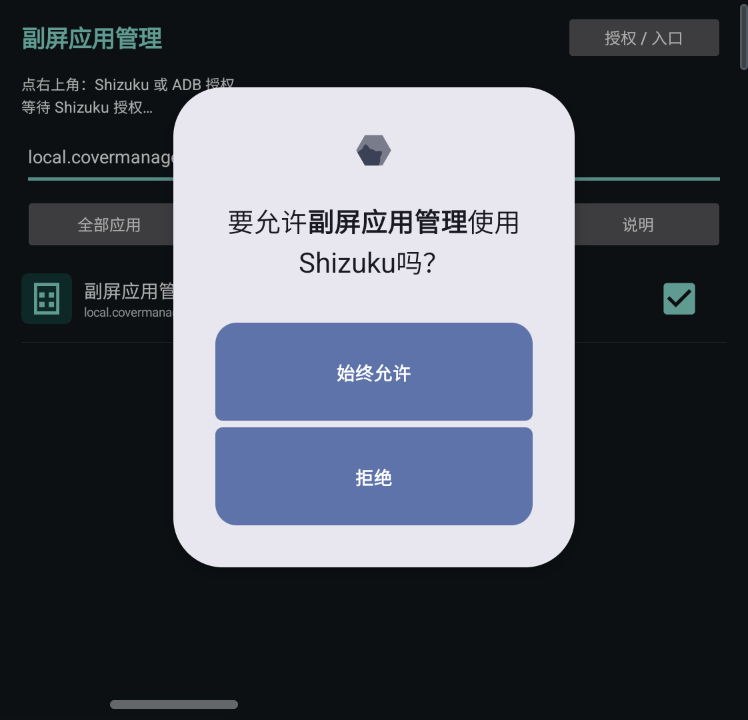
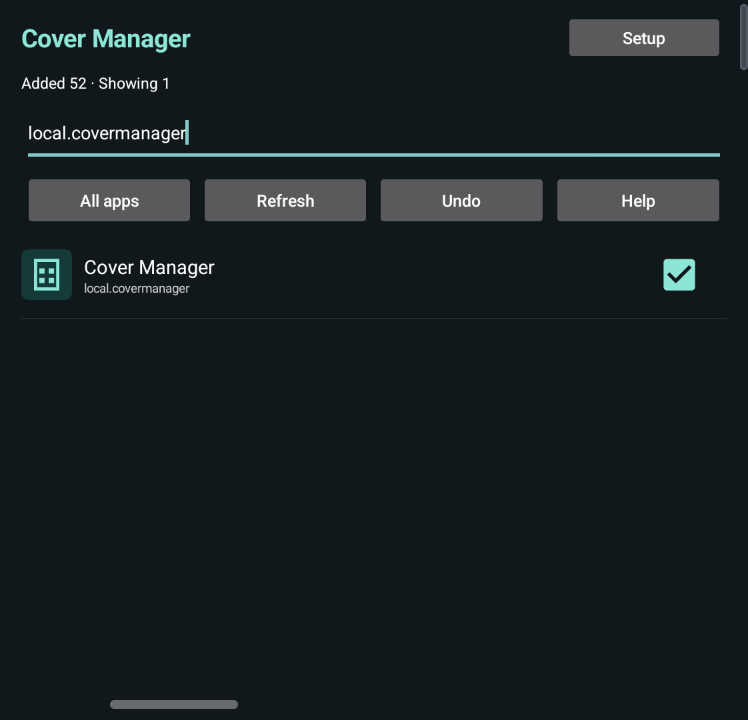

# 副屏应用管理 · Z Flip Cover Manager

简体中文 · [English](README.en.md)

在 Galaxy Z Flip5 副屏管理 MultiStar 应用名单。授权一次后，新装的 App 也能直接从副屏添加，无需打开主屏幕。

**[下载 APK](https://github.com/andyfanybo/zflip-cover-manager/releases/latest)** · [实现原理](docs/implementation.md) · [MIT License](LICENSE)

## 界面

| 首次设置 | Shizuku 授权 | 英文界面 |
| --- | --- | --- |
|  |  |  |

截图仅显示本工具。清空搜索框可查看全部应用。

## 安装

### Shizuku

1. 安装并启动 [Shizuku](https://shizuku.rikka.app/zh-hans/)（v13 及以上）。
2. 安装 APK，打开“副屏应用管理”。
3. 点“授权 / 入口”→“通过 Shizuku 授权并添加入口”，在提示中允许。

完成后无需 Shizuku 持续运行。主屏损坏时，仍需有办法首次打开本工具；如果现有副屏启动器无法打开它，使用下面的 ADB 方式。

### ADB

从下载页获取 APK 和 `setup.ps1`，在装有 Android Platform Tools 的 Windows 电脑运行：

```powershell
.\setup.ps1 -Device '设备序列号或IP:端口' -ApkPath '.\CoverManager-v0.3.1.apk'
```

脚本会安装、授权、备份配置并添加副屏入口。备份保存在当前目录的 `.covermanager-backups`。

也可以手动安装和授权：

```sh
adb -s DEVICE install -r CoverManager-v0.3.1.apk
adb -s DEVICE shell pm grant local.covermanager android.permission.WRITE_SECURE_SETTINGS
adb -s DEVICE shell am start --display 1 -n local.covermanager/.MainActivity
```

打开后点“授权 / 入口”→“已有 ADB 权限：添加 / 修复入口”。手机需先解锁；测试机的副屏 ID 为 `1`。

## 使用

- 新装 App 后点“刷新”，搜索并勾选即可添加；取消勾选即可移除。
- MultiStar 图标未更新时，切换一次副屏小组件。
- “撤销”恢复上一次名单修改。若其他程序已改动配置，会停止撤销。
- 字体跟随系统。默认中文系统显示中文，其余语言显示英文，也可在设置中手动切换。

不限制 MultiStar 版本；配置格式无法识别时只读。实测环境为 Z Flip5 SC-54D、Android 15 / One UI 7、MultiStar 9.1.09。最低系统为 Android 11。

## 构建

需要 JDK 17、Android SDK Platform 35、Build Tools 35.0.0：

```powershell
.\build.ps1 -Jdk 'C:\path\to\jdk-17' -AndroidSdk 'C:\path\to\Android\Sdk'
```

输出为 `build/CoverManager-v0.3.1.apk`。脚本会下载并校验 Shizuku 依赖，运行测试，生成开发签名。自行构建的签名与 Release 不同，请保留自己的签名文件供后续更新。

问题反馈见 [Issues](https://github.com/andyfanybo/zflip-cover-manager/issues)，请注明机型和系统、MultiStar 版本。不要附上完整配置备份或个人应用列表。

本项目采用 [MIT License](LICENSE)，Shizuku 版权声明见 [第三方许可证](docs/SHIZUKU-LICENSE.txt)。
