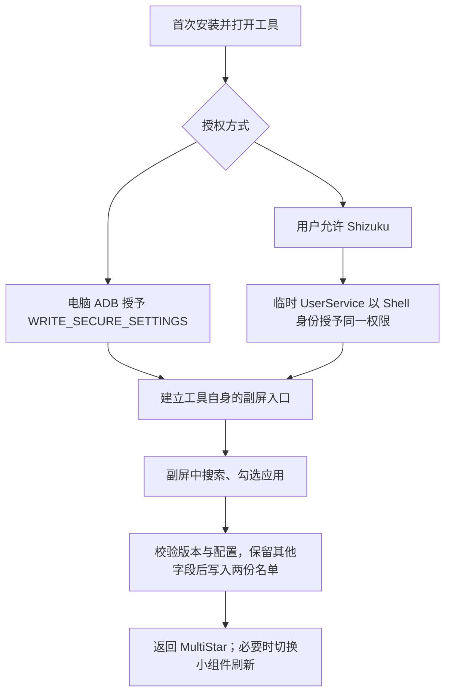

# 实现原理与验证记录

## 路径

这不是屏幕投射，也不是模拟点击 MultiStar 主屏设置。工具直接更新 MultiStar 9.1.09 使用的系统安全设置。

## 配置格式

已检查安装在测试机上的 MultiStar 9.1.09 APK 清单与 DEX。相关内部设置 Activity 未导出；本项目不分发 Samsung APK 或反编译源码。

存储位置：`Settings.Secure.multistar_setting_repository`。

- 27 个以 `/` 分隔的字段，末尾保留 `/`。
- 以 0 起始，索引 20：`包名;包名`。
- 索引 25：`包名,用户ID;包名,用户ID`。
- 空名单使用 `0`。

`Repository.java` 校验字段数、末尾分隔符、包名与用户 ID，修改上述两份名单并保留其他字段原文。移除当前用户的包名时，如果其他用户仍有同包名条目，会保留兼容名单中的包名。多用户保留逻辑完成了解析器测试；完整工作资料用户环境未做真机验证。

MultiStar 存在配置观察与组件更新逻辑，但副屏图标刷新可能有延迟。实际使用中可切换小组件；不通过强制停止 SystemUI 来刷新。

## Shizuku

采用官方 Shizuku API 13.1.5 的 Provider 和 UserService。用户通过标准 Shizuku 确认框允许后，临时 Shell 进程执行固定的 `pm grant --user USER local.covermanager android.permission.WRITE_SECURE_SETTINGS`。

服务从 Shizuku 提供的本应用 Context 获取应用 UID，限制调用方，不从客户端接受任意命令。权限授予完成后主动解绑并退出。设置读写、入口修复和撤销均在 App 本身完成。

权限被系统撤销、卸载重装或换机后需要重新授权。Shizuku 停止后，已授予的开发权限通常仍保留；应以本机显示的权限状态为准。

## 验证记录

测试设备：SC-54D / Android 15 / One UI 7 / MultiStar 9.1.09。

| 检查 | 结果 |
| --- | --- |
| APK 编译、签名校验 | 通过 |
| 配置解析器：其他字段保留、重复添加、增删往返、跨用户条目保留、异常格式拒绝 | 通过 |
| ADB 安装与权限授予 | 通过 |
| 在副屏勾选应用，再撤销 | 两份名单同步变更；撤销后完整配置与测试前一致 |
| 从 MultiStar 图标打开工具 | 真机确认通过 |
| 撤销原有 WRITE_SECURE_SETTINGS 后，通过 Shizuku 重新授权 | 真机通过，系统权限回读为 granted |
| Shizuku 授权完成后，临时进程退出 | 通过 |
| 再次授权时保留原有名单 | 完整设置字符串与测试前一致 |

上述真机验证不等于所有机型或 MultiStar 版本都兼容。权限拒绝、Shizuku 未运行、超时等分支提供了错误提示，未穷举所有系统组合。
